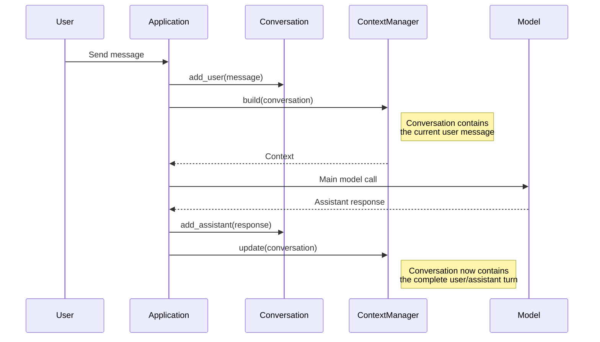

# Context Policy API

A context policy decides **what the language model receives on each turn**. For a simple policy, the job is mainly to select messages from the stored conversation. More advanced policies may also retain information across turns or make an additional model call to maintain that information.

The rest of the application is already in place. It stores the conversation, calls Ollama, records traces, runs evaluation scenarios, and presents the interactive interface. Your policy operates inside that loop. The interfaces described in this document are everything that a policy needs to know about the rest of the application.

## Implementing a policy

Your task for this project is to implement the context policies located in the `assistant/context` directory. They inherit from the `ContextManager` interface:

```python
class ContextManager:
    def build(self, conversation: Conversation) -> Context:
        ...

    def update(self, conversation: Conversation) -> None:
        ...

    def state(self) -> dict:
        ...

    def reset(self) -> None:
        ...
```

The application calls these methods at different points in each conversation turn:

- `build()` is called to construct the context that the model receives to answer the current user message. It takes the stored conversation as input, which contains the current user message at the last position. It returns a `Context` containing the ordered messages that should be sent to the model. **This method must be implemented by all policies**.

- `update()` is called after the model has produced its response. It takes the stored conversation as input, which now contains the complete user/assistant turn. It does not return anything. This method is the natural place for a stateful policy to revise information that should be available on later turns.

- `state()` is called when the application wants to inspect the policy's retained information. It returns a dictionary representing the current internal state of the policy. The application uses this information for debugging. **This method should not modify the policy's state**, because it is called multiple times per turn.

- `reset()` is called when the conversation is reset. It should clear any conversation-specific state that the policy has retained.

The application also provides each policy with two useful attributes:

- `self.recent_turns` contains the configured history-window size. It is useful for policies that operate on a fixed number of recent turns.

- `self.model_call` is a callable that allows policies to make additional model calls for context maintenance. It can be used to update summaries, extract information, or perform other tasks that require the model's assistance.

A user turn follows this sequence:




## Conversation

The complete transcript of the conversation up to the current turn is stored in a `Conversation` object. It is passed to both `build()` and `update()` methods. The full sequence of messages is available through the `messages` attribute:

```python
history = conversation.messages
```

A conversation begins with the system message. User and assistant messages are then appended in order. For example, just before the assistant answers a user message, the stored conversation may look like this:

```text
id    role         content

0     system       You are a study assistant...
1     user         First question
2     assistant    First answer
3     user         Second question
4     assistant    Second answer
5     user         Third question
```

Your policy reads the conversation history and decides which information should be passed to the model. Selecting fewer messages for a request does not delete anything from the conversation.

### Message

Each stored message contains an ID, a role, and its original content:

- `message.id` is a unique integer identifying the message within the conversation. It is assigned when the message is added and never changes.

- `message.role` is a string indicating the role of the message. It is one of `"system"`, `"user"`, or `"assistant"`.

- `message.content` is the text stored when the message was added. It is not modified by the policy.

When you want to send a stored message to the model unchanged, just select it from the conversation. A policy may also construct `Message` objects when the model should receive transformed or separately maintained information, such as retained state added to the system prompt.

Keep the original message ID when constructing a transformed version of a stored message. Use `id=None` only when the new message has no counterpart in the stored conversation:

```python
# A transformed version of the stored system message
transformed = Message(
    id=history[0].id,
    role="system",
    content=history[0].content + "\n\nAdditional context",
)

# A new message created only for this model request
model_only = Message(
    id=None,
    role="system",
    content="Additional context",
)
```

### Complete turns

Some policies operate on conversation **turns** rather than individual messages. A completed turn consists of a user message followed by its assistant response. When `build()` runs, the latest user message is still waiting for its response, so the conversation has this general shape:

```text
system

user
assistant

user
assistant

user       ← current request
```

If a policy is defined in terms of the most recent `N` turns, it should therefore keep complete user/assistant pairs. The current user message and system prompt do not count toward this number. The configured number of recent turns is available through `self.recent_turns`. There is no need for a policy to read `config.toml` itself.

## Building a context

The central method of every policy is:

```python
def build(self, conversation: Conversation) -> Context:
    ...
```

Its job is to return a `Context` with the messages that should be sent to the model. A context is constructed from a list of messages:

```python
messages = ... # selected from conversation or constructed directly

context = Context(messages)
```

The `messages` list defines the ordered sequence sent to Ollama for text generation. It may contain messages selected from the stored conversation or `Message` objects constructed by the policy. Immediately before the model call, the application removes each message ID and sends only its role and content.

## Stateful policies

A policy that only selects messages from the transcript may not need anything beyond `build()`. A stateful policy, on the other hand, may retain information across turns. The remaining methods of the `ContextManager` interface are designed to support that.

### `update()`

The application calls:

```python
def update(self, conversation: Conversation) -> None:
    ...
```

after the main assistant response has been generated and stored. At that point, the latest user/assistant pair is complete:

```python
history = conversation.messages
user = history[-2]
assistant = history[-1]
```

A stateful policy can keep its internal representation in ordinary instance attributes:

```python
self.memory = ...
self.summary = ...
```

If the retained information should influence a later assistant response, `build()` must place the relevant part of it into `Context.messages`. For example, a policy might maintain a summary of the conversation so far; its `build()` method would append that summary to the system message in the returned context.

### Additional model calls

Some policies may use the language model itself to maintain their state, for example by updating a summary or extracting information worth retaining. Policies can make these auxiliary calls through:

```python
result = self.model_call(messages)
```

If the maintenance step is easier to process as structured JSON:

```python
result = self.model_call(messages, format="json")
```

The returned [ModelResult](assistant/model.py) contains the generated text and other information about the call:

```python
result.text
result.usage
result.done_reason
```

The application does not use this result for the main assistant response; it is only for context maintenance.

### `state()`

A stateful policy should make its retained information inspectable through:

```python
def state(self) -> dict:
    ...
```

A stateful policy might expose something such as:

```python
{
    "memory": ...,
    "summary": ...,
}
```

The returned dictionary must be JSON-serializable. It is used for inspection and evaluation, but it is not automatically included in the model context.

Evaluation records expose the policy state at two points in each turn:

- `manager_state_before` is captured immediately after `build()` and before the main model call;
- `manager_state_after` is captured after `update()` completes and is therefore the state available on the next turn.

The interactive context inspector shows the same transition. This makes it possible to inspect when retained information is introduced, replaced, or removed.

### `reset()`

When the conversation is reset, the application calls:

```python
context_manager.reset()
```

A stateful policy should use `reset()` to clear all conversation-specific state.

```python
def reset(self) -> None:
    self.memory = ...
    self.summary = ...
```

A policy with no persistent state normally does not need to override it.
