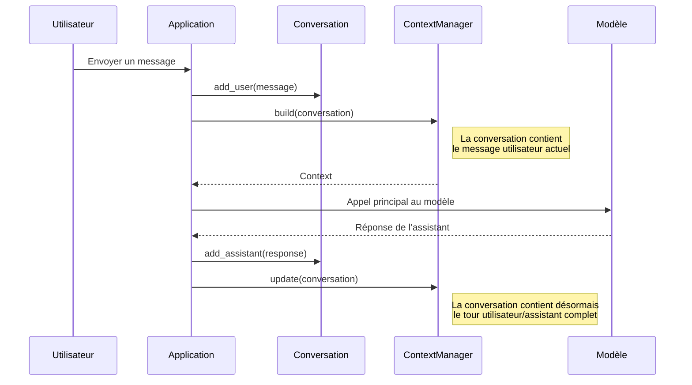

# API des politiques de contexte

Une politique de contexte détermine **ce que le modèle de langage reçoit à chaque tour**. Pour une politique simple, le travail consiste principalement à sélectionner des messages dans la conversation. Des politiques plus avancées peuvent également conserver des informations entre les tours ou effectuer un appel supplémentaire au modèle afin de maintenir ces informations.

Le reste de l’application est déjà en place. Elle gère la conversation, appelle Ollama, enregistre des traces, exécute des scénarios d’évaluation et présente l’interface interactive. Votre politique fonctionne à l’intérieur de cette boucle. L'API décrites dans ce document est tout ce qu’une politique doit connaître du reste de l’application.

## Implémenter une politique

Votre tâche pour ce projet consiste à implémenter les politiques de contexte situées dans le répertoire `assistant/context`. Elles héritent de l’interface `ContextManager` :

```python
class ContextManager:

    def build(self, conversation: Conversation) -> Context:
        ...

    def update(self, conversation: Conversation) -> None:
        ...

    def state(self) -> dict:
        ...

    def reset(self) -> None:
        ...
```

L’application appelle ces méthodes à différents moments de chaque tour de conversation :

- `build()` est appelée pour construire le contexte que le modèle reçoit afin de répondre au message actuel de l’utilisateur. Elle prend en entrée l'historique de la conversation, qui contient le message actuel de l’utilisateur en dernière position. Elle renvoie un `Context` contenant les messages ordonnés qui doivent être envoyés au modèle. **Cette méthode doit être implémentée par toutes les politiques**.

- `update()` est appelée après que le modèle a produit sa réponse. Elle prend en entrée l'historique de la conversation, qui contient désormais le tour utilisateur/assistant complet. Elle ne renvoie rien. Cette méthode est l’endroit naturel où une politique avec état peut réviser les informations qui devront être disponibles lors des tours suivants.

- `state()` est appelée lorsque l’application souhaite inspecter les informations conservées par la politique. Elle renvoie un dictionnaire représentant l’état interne actuel de la politique. L’application utilise ces informations pour le débogage. **Cette méthode ne doit pas modifier l’état de la politique**, car elle est appelée plusieurs fois par tour.

- `reset()` est appelée lorsque la conversation est réinitialisée. Elle doit effacer tout état propre à la conversation que la politique a conservé.

L’application fournit également à chaque politique deux attributs utiles :

- `self.recent_turns` contient la taille configurée de la fenêtre d’historique. Il est utile pour les politiques qui fonctionnent avec un nombre fixe de tours récents.

- `self.model_call` est un objet appelable qui permet aux politiques d’effectuer des appels supplémentaires au modèle pour la maintenance du contexte. Il peut servir à mettre à jour des résumés, extraire des informations ou effectuer d’autres tâches nécessitant l’aide du modèle.

Un tour utilisateur suit cette séquence :




## Conversation

La transcription complète de la conversation jusqu’au tour actuel est stockée dans un objet `Conversation`. Celui-ci est transmis aux méthodes `build()` et `update()`. La séquence complète des messages est accessible via l’attribut `messages` :

```python
history = conversation.messages
```

Une conversation commence par le message système. Les messages de l’utilisateur et de l’assistant sont ensuite ajoutés dans l’ordre. Par exemple, juste avant que l’assistant réponde à un message de l’utilisateur, la suite de messages peut ressembler à ceci :

```text
id    role         content

0     system       Vous êtes un assistant d'étude...
1     user         Première question
2     assistant    Première réponse
3     user         Deuxième question
4     assistant    Deuxième réponse
5     user         Troisième question
```

Votre politique lit l’historique de la conversation et décide quelles informations doivent être transmises au modèle. Sélectionner moins de messages pour une requête ne supprime rien de la conversation.

### Message

Chaque message contient un identifiant, un rôle et son contenu d’origine :

- `message.id` est un entier unique qui identifie le message dans la conversation. Il est attribué lorsque le message est ajouté et ne change jamais.

- `message.role` est une chaîne indiquant le rôle du message. Sa valeur est `"system"`, `"user"` ou `"assistant"`.

- `message.content` est le texte stocké lorsque le message a été ajouté. Il n’est pas modifié par la politique.

Lorsque vous souhaitez envoyer au modèle un message sans le modifier, sélectionnez-le simplement dans la conversation. Une politique peut également construire des objets `Message` lorsque le modèle doit recevoir des informations transformées ou maintenues séparément, par exemple un résumé de la conversation à ajouter au prompt système.

Conservez l’identifiant d’origine du message lorsque vous construisez une version transformée d’un message. Utilisez `id=None` uniquement lorsque le nouveau message n’a aucun équivalent dans la conversation :

```python
# Version transformée du message système
transformed = Message(
    id=history[0].id,
    role="system",
    content=history[0].content + "\n\nContexte supplémentaire",
)

# Nouveau message créé uniquement pour cette requête au modèle
model_only = Message(
    id=None,
    role="system",
    content="Contexte supplémentaire",
)
```

### Tours complets

Certaines politiques fonctionnent sur des **tours** de conversation plutôt que sur des messages individuels. Un tour terminé se compose d’un message utilisateur suivi de la réponse de l’assistant. Lorsque `build()` s’exécute, le dernier message utilisateur attend encore sa réponse ; la conversation présente donc généralement cette forme :

```text
system

user
assistant

user
assistant

user       ← requête actuelle
```

Si une politique est définie en fonction des `N` tours les plus récents, elle doit donc conserver des paires utilisateur/assistant complètes. Le message utilisateur actuel et le prompt système ne comptent pas dans ce nombre. Le nombre configuré de tours récents est disponible via `self.recent_turns`. Une politique n’a pas besoin de lire elle-même `config.toml`.

## Construire un contexte

La méthode centrale de chaque politique est :

```python
def build(self, conversation: Conversation) -> Context:
    ...
```

Son rôle est de renvoyer un `Context` contenant les messages qui doivent être transmis au modèle. Un contexte est construit à partir d’une liste de messages :

```python
messages = ... # sélectionnés dans la conversation ou construits directement

context = Context(messages)
```

La liste `messages` définit la séquence ordonnée envoyée à Ollama pour la génération de texte. Elle peut contenir des messages sélectionnés dans la conversation ou des objets `Message` construits par la politique. Juste avant l’appel au modèle, l’application supprime l’identifiant de chaque message et n’envoie que son rôle et son contenu.

## Politiques avec état

Une politique qui se contente de sélectionner des messages dans la conversation peut ne rien nécessiter au-delà de `build()`. En revanche, une politique avec état peut conserver des informations entre les tours. Les autres méthodes de l’interface `ContextManager` sont conçues pour cela.

### `update()`

L’application appelle :

```python
def update(self, conversation: Conversation) -> None:
    ...
```

après que la réponse principale de l’assistant a été générée et stockée. À ce moment-là, la dernière paire utilisateur/assistant est complète :

```python
history = conversation.messages
user = history[-2]
assistant = history[-1]
```

Une politique avec état peut conserver sa représentation interne dans des attributs d’instance ordinaires :

```python
self.memory = ...
self.summary = ...
```

Si les informations conservées doivent influencer une réponse ultérieure de l’assistant, `build()` doit placer la partie pertinente de ces informations dans `Context.messages`. Par exemple, une politique peut maintenir un résumé de la conversation ; sa méthode `build()` ajouterait alors ce résumé au message système dans le contexte renvoyé.

### Appels supplémentaires au modèle

Certaines politiques peuvent utiliser le modèle de langage lui-même pour maintenir leur état, par exemple en mettant à jour un résumé ou en extrayant des informations qu’il est utile de conserver. Les politiques peuvent effectuer ces appels supplémentaires via :

```python
result = self.model_call(messages)
```

Si l’étape de maintenance est plus facile à traiter sous forme de JSON structuré :

```python
result = self.model_call(messages, format="json")
```

Le [ModelResult](assistant/model.py) renvoyé contient le texte généré et d’autres informations sur l’appel :

```python
result.text
result.usage
result.done_reason
```

L’application n’utilise pas ce résultat pour la réponse principale de l’assistant ; il sert uniquement à la maintenance du contexte.

### `state()`

Une politique avec état doit permettre d’inspecter les informations qu’elle conserve via :

```python
def state(self) -> dict:
    ...
```

Une politique avec état peut, par exemple, exposer quelque chose comme :

```python
{
    "memory": ...,
    "summary": ...,
}
```

Le dictionnaire renvoyé doit être sérialisable en JSON. Il est utilisé pour l’inspection et l’évaluation, mais n’est pas automatiquement inclus dans le contexte du modèle.

Les enregistrements d’évaluation exposent l’état de la politique à deux moments de chaque tour :

- `manager_state_before` est capturé immédiatement après `build()` et avant l’appel principal au modèle ;
- `manager_state_after` est capturé après la fin de `update()` et correspond donc à l’état disponible au tour suivant.

L’inspecteur de contexte affiche la même transition. Cela permet d’examiner à quel moment les informations conservées sont introduites, remplacées ou supprimées.

### `reset()`

Lorsque la conversation est réinitialisée, l’application appelle :

```python
context_manager.reset()
```

Une politique avec état doit utiliser `reset()` pour effacer tout état propre à la conversation.

```python
def reset(self) -> None:
    self.memory = ...
    self.summary = ...
```

Une politique sans état persistant n’a normalement pas besoin de redéfinir cette méthode.
